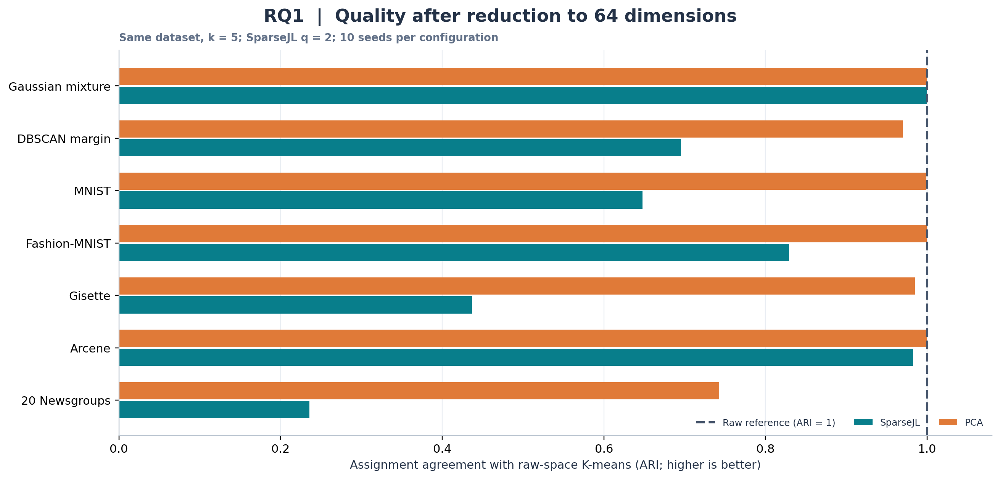
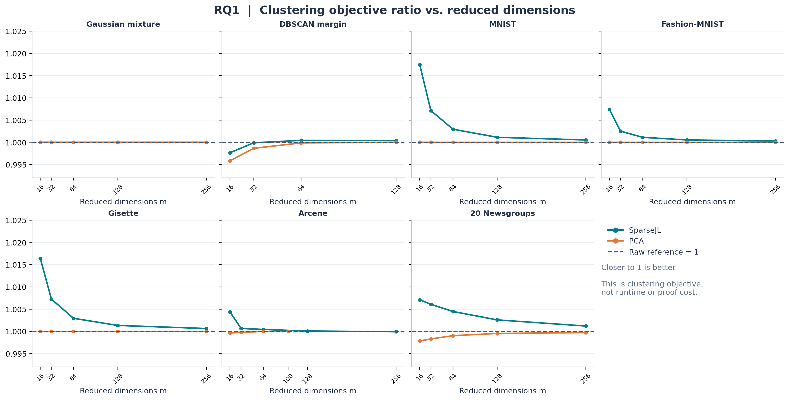
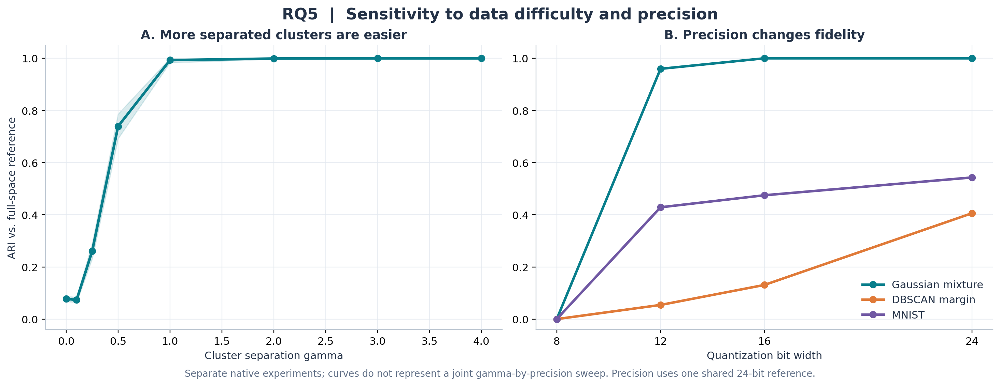
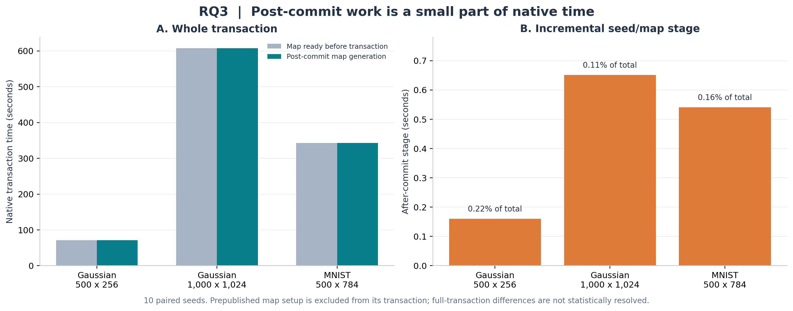

# Project overview for authors

This project asks whether a **sparse, randomly chosen dimension-reduction map** can preserve useful clustering results while fitting a commit-then-challenge zero-knowledge protocol. The laptop runs show where clustering quality survives reduction. They **do not yet show a successful full-size ZK proof**: both selected RQ2 proof attempts hit the memory watchdog.

**How to read the numbers.** `n` is the number of analyzed points, `d` the original number of features, and `m` the number after reduction. ARI measures how closely the reduced-data cluster assignments match K-means assignments on the original data: 1 means identical assignments, 0 means chance-level agreement. It is **not** accuracy against the dataset's true labels. The raw full-space reference has ARI 1 by definition. Each main configuration has ten recorded seeds; the plots show means, with a seed-level 95% interval on the separation chart.

## Which data actually ran?

| Dataset | Type | Source pool / features | RQ1 tested `n x d` |
| --- | --- | --- | --- |
| Gaussian mixture | Synthetic | Synthetic; generated for each shape | 2,000 x 256, 2,000 x 512 |
| DBSCAN margin | Synthetic | Synthetic; generated for each shape | 1,000 x 128 |
| MNIST | Real | 70,000 x 784 | 5,000 x 784 |
| Fashion-MNIST | Real | 70,000 x 784 | 5,000 x 784 |
| Gisette | Real | 6,000 x 5,000 training set | 3,000 x 5,000 |
| Arcene | Real | 100 x 10,000 training set | 100 x 10,000 |
| 20 Newsgroups | Real | 11,314 training texts; 2,000 TF-IDF features | 3,000 x 2,000 |

The real-data rows use the displayed samples, not whole source datasets. Arcene's 100 training rows are the entire training pool used by its loader; its nominal `n_max=200` could not increase that pool. The 20 Newsgroups representation is a fitted 2,000-feature TF-IDF matrix, not raw text. The two synthetic families have no larger source pool. RQ1 applies K-means comparisons even to the DBSCAN-margin generator; RQ4 separately checks DBSCAN neighbor-pair stability. RQ3-RQ5 use targeted, generally smaller samples: RQ3 uses Gaussian `500 x 256`, Gaussian `1,000 x 1,024`, and MNIST `500 x 784`; the RQ4 real supplement uses 1,000 rows each from MNIST, Fashion-MNIST, Gisette and 20 Newsgroups, plus all 100 Arcene training rows; RQ5 precision uses Gaussian `1,000 x 256`, DBSCAN margin `1,000 x 128`, and MNIST `1,000 x 784`.

## What did each research question test?

| Question | Plain-language test | What completed |
| --- | --- | --- |
| **RQ1 — clustering quality and reduction** | After compressing from `d` to `m` features, do points still join the same clusters as in full space? How does SparseJL compare with PCA and other native baselines? | 7,180 successful **native** rows, seven dataset families, ten seeds per configuration. |
| **RQ2 — ZK proving cost and memory** | Can the protocol prove its commitment, projection and assignments, and how much time, memory and circuit size does that take? | Two representative full-shape proof attempts, **zero successes**. Gaussian `2,000 x 256 -> 16` and Arcene `100 x 10,000 -> 16` stopped at the memory watchdog. No measured full-shape prover cost. |
| **RQ3 — security and post-commit overhead** | What host work is added when the map is fixed only after the data commitment? How does a prepublished map compare, and what does grinding show? | 90 overhead, 540 grinding, and 30 paired **native** rows. Beacon is a **simulated local trace**, not an external beacon. Grinding is simulation, not a proof of adversarial security. |
| **RQ4 — certificates and boundary cases** | Can margin checks identify stable cluster assignments or stable DBSCAN neighbor relations? What happens near the boundary? | 265 synthetic and 100 real-data **native** rows. The certificate theorem's embedding condition must hold before its guarantee applies. |
| **RQ5 — sensitivity and quantization** | How do cluster separation, shape, sparsity and precision affect clustering quality? | 200 scaling, 80 separation, and 150 comparable 24-bit-reference precision **native** rows. The separate older 20-bit-reference sweep has 120 rows and should not be mixed into the same precision curve. |

Across these named campaigns, 8,755 native rows succeeded and the two selected full-shape ZK rows failed. Smaller earlier ZK smoke proofs do not replace the missing RQ2 measurements. Proof-based ablation is also unavailable at paper shapes. RQ2 input commitment covers `n x d` coordinates even when projected distance work uses only `m` dimensions, so a small `m` alone does not imply a small prover memory footprint.

## Four pictures of the measured results

### A. Quality at the same reduced dimension

The plot fixes `m=64` and `k=5` in every dataset, with SparseJL `q=2`; PCA has no active `q`. Gaussian uses the `d=256` shape. The dashed raw line is the definition of the reference, not an independent win. SparseJL matches the raw Gaussian clustering (ARI 1.000) and stays close on Arcene (0.982); it falls behind PCA on MNIST (0.648 vs 0.999), Gisette (0.437 vs 0.985), and 20 Newsgroups (0.236 vs 0.743). These are assignment-fidelity comparisons at the same `m`, **not** ground-truth-label or ZK-cost comparisons.

### B. Clustering objective ratio across dimensions

This ratio compares the full-space clustering objective obtained from reduced-data assignments with the raw reference cost. A value near 1 means a similar objective, even when individual assignments differ. **It is not a time, RAM, or circuit-cost ratio.** The near-1 lines alongside lower ARI on some real datasets show why both quality metrics matter. More dimensions generally help assignment fidelity, but the objective ratio by itself can hide moved boundary points.

### C. Cluster separation and precision

On the controlled Gaussian generator, mean ARI rises from 0.078 at `gamma=0` to 0.739 at `gamma=0.5` and 0.993 at `gamma=1`. At a shared 24-bit physical reference, 8-bit quantization collapses every tested matrix to zero. Increasing precision from 16 to 24 bits improves mean ARI on the difficult DBSCAN-margin data (0.131 to 0.406) and MNIST (0.475 to 0.543). Sixteen bits is **not established as optimal**. The precision plot deliberately uses 8, 12, 16 and 24 bits from one normalization regime; it does not combine the older 20-bit-reference run. No real gnark constraint-vs-precision curve was measured.

### D. Native post-commit overhead

The added after-commit seed/map stage averaged 0.160, 0.651, and 0.541 seconds across the three shapes, around 0.22%, 0.11%, and 0.16% of their total native transactions. The full-transaction paired difference has a 95% interval crossing zero in every shape, so the experiment does **not** resolve an overall speed difference. Prepublished map preparation is measured separately and excluded from that baseline transaction. The run used competing local processes, and no ZK proving time or external beacon latency is included.

## Where SparseJL works, and where it falls short

- **Best observed behavior:** It preserves the easy, well-separated Gaussian assignments even at low `m` and performs well on Arcene's small training set. Its native after-commit map work is a small fraction of the whole transaction. Its sparse entries and transcript-derived map are structurally suited to a circuit that authenticates a challenged projection.
- **Data-dependent losses:** On MNIST, Gisette and 20 Newsgroups, SparseJL has much lower native assignment agreement than PCA at `m=64`. At `m=256, q=2, k=5`, SparseJL still reaches only about 0.693 ARI on Gisette and 0.552 on 20 Newsgroups. This is a strong limit on any blanket quality claim.
- **Certificate limits:** In all 100 real-data RQ4 rows, the required *global* embedding condition fails. Among 2,457 certified points satisfying the checked pointwise condition, none changed assignment, but unconditional certified assignment changes occurred when that premise failed. The approximately 99.95% DBSCAN pair coverage is dominated by far pairs; only 250 of 499,500 pairs per synthetic row are in the difficult near-radius band.
- **Precision and prover limits:** Eight-bit quantization destroys the tested signal. On difficult data, 24 bits beats 16 bits under the common reference. Both selected full-shape ZK proofs exceeded the laptop watchdog, so no measured prover advantage, memory curve, verification rate, or proof-based ablation can be claimed.
- **Why choose SparseJL over PCA?** PCA is often the better *native* fidelity baseline here. SparseJL remains interesting because its challenged sparse map can be reconstructed and checked inside the intended proof protocol without first fitting a data-dependent PCA basis. That is a **structural motivation**, not a measured full-size proof-cost victory; RQ2 must succeed before claiming that advantage empirically.

For paper use, describe these as ten-seed native results on the shown samples. The current files use seed-level Student-t intervals; the manuscript's described 30 projection seeds, ten clustering starts, hierarchical bootstrap and Holm adjustment were not executed here. The complete statistical design or the manuscript methods must be reconciled before final publication. See [the detailed analysis](analysis.md) and [paper-readiness review](paper_readiness_review.md) for supporting tables and caveats.
